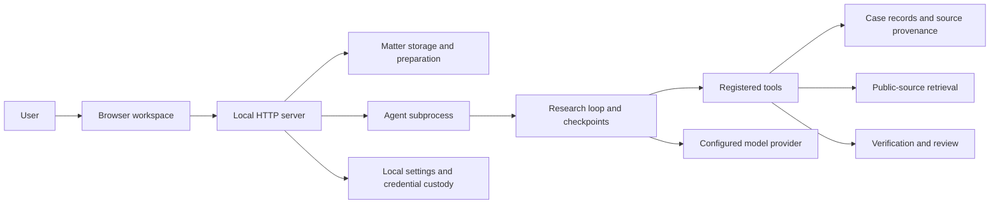

# Legal Agent architecture

Adopted 2026-11-05. The [foundational directive](directive.md) is the repository's
portable architectural baseline. It preserves the shared philosophy without
depending on machine-local instruction files. Changes to this copy should be
reviewed explicitly; local policy changes do not silently update repository
contracts.

## Current execution and boundaries

Legal Agent is a trusted local workspace with a Python HTTP server, browser UI,
and agent subprocesses. Its modules share local storage and account permissions.
They are logical boundaries, not independently deployed or sandboxed services.

The diagram shows responsibility flow, not network isolation or every Python
import. UI state and domain records remain distinct: a displayed success state
must follow the saved operation, and delivered steering is not proof of model
compliance.

| Capability | Current implementation and owned responsibility | Contract boundary |
| --- | --- | --- |
| Workspace | `ui/matters.js`, editors and source inspectors | User actions, escaped rendering, saved records, visible execution state |
| Application coordination | `ui/ui.py`, `ui/matters.py` | HTTP validation, matter/run scoping, preparation, runner ownership and recovery |
| Intelligence execution | `agent/legal_agent/loop.py`, `research_control.py`, `attention.py` | Bounded model/tool turns, steering checkpoints, progress and stop reasons |
| Task interpretation | `agent/agent_kit/task_understanding.py` | Server-owned original request/context, versioned model assessment, stale detection |
| Tool dispatch | `agent/agent_kit/tools/__init__.py`, `argument_validation.py` | Explicit registration, argument validation and structured outcomes |
| Evidence and knowledge | `agent/agent_kit/case_record.py`, `research_tree.py`, `progress.py` | Persisted evidence, source references, work assessments and execution checkpoints |
| Discovery | `agent/agent_kit/public_sources.py`, `caselaw.py` | Bounded retrieval through supported sources; discovery leads remain distinct from evidence |
| Quality and review | `agent/verification/`, `agent/quality/`, `submit_memo` | Quote and structured checks, model-dependent review, submission state and limitations |
| Provider access | `agent/agent_kit/client.py`, `settings.py`, `secrets.py` | Configured SDK endpoint, model and credential resolution; compatibility requires verification |
| Local configuration | `ui/local_settings.py` | Write-only key settings, local file permissions and process configuration |

Shared case records are currently a coupling point. A module name does not
establish exclusive ownership of a storage schema. Future extraction must
identify writers and consumers before changing persistence or adding services.

## Extension and governance rules

- Add tools through the explicit registry and schema validation path. Capability
  registration does not itself authorize external actions or arbitrary execution.
- Keep provider details behind the existing client/configuration boundary.
  Verify tool calls, document behavior, errors and retries before claiming a
  second provider is supported.
- Keep retrieval adapters separate from legal assessment. Preserve source URL,
  captured text and provenance; source access does not establish applicability.
- Preserve matter/run scope and server ownership of user intent, execution
  receipts and credentials. Model-authored plans and interpretations remain
  assessments.
- Keep permission enforcement outside model instructions. The current local
  process boundary is not an operating-system sandbox or multi-tenant identity
  system. Introducing either requires an explicit security design.
- Before extracting an engine, define its state owner, versioned input/output
  contract, permissions, failure behavior, observability, migration and rollback.
  Extract only for a demonstrated isolation, workload or lifecycle need.

The separate [hierarchical orchestration design](../orchestration-architecture.md)
describes an opt-in implementation and historical evaluation work. Its runtime
uses scripted semantic judgments and is not the default live investigation
loop. It must not be presented as a deployed autonomous multi-engine platform.

## Next architectural improvements and acceptance evidence

These are proposed increments, not implemented capabilities or an instruction
to undertake an unrelated rewrite.

| Increment | Evidence required before calling it complete |
| --- | --- |
| Narrow the application coordination boundary | Extract a cohesive server responsibility while preserving HTTP behavior, matter/run scoping, Send, Queue, Steer and recovery journeys |
| Define versioned engine contracts | Validate producer/consumer compatibility, reject malformed or incompatible outputs before writes, and preserve an old saved run through a documented migration |
| Make evidence invalidation explicit across assessments | A changed source or user interpretation identifies affected conclusions; unaffected evidence remains intact, and stale conclusions cannot appear currently verified |
| Add isolated execution | Exercise filesystem, network, credential and resource restrictions at the actual runtime boundary, including cancellation and failure recovery |
| Introduce a second provider or retrieval adapter | Run the same contract scenarios against the adapter, including unavailable tools, malformed output, timeout and partial failure; record supported behavior and limits |

Use the relevant offline tests and browser journeys listed in the root README.
Fixture checks establish mechanics; live-provider checks and legal-quality
evaluation are separate evidence. Record architecture decisions in this directory
with the problem, alternatives, chosen boundary, rollout, rollback and acceptance
criteria. Keep current behavior and target architecture clearly distinguished.
